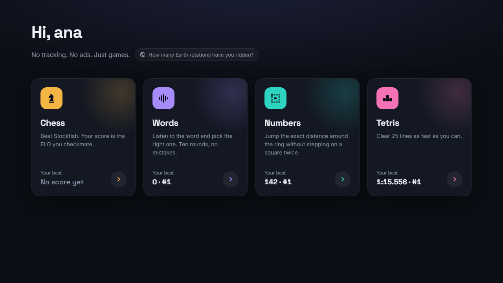
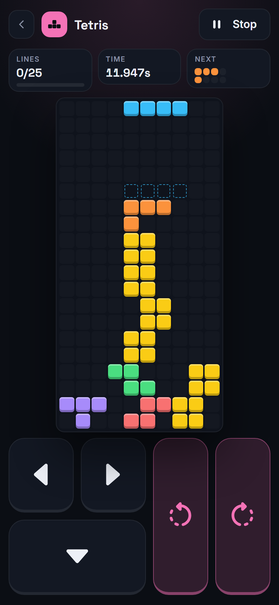

# Games

Chess, words, numbers and Tetris, played with your Nextcloud account. No
tracking. No ads. Just games.

**Play it live:** [games.ideniox.com](https://games.ideniox.com)

<p>
  
  &nbsp;
  
</p>

## ABOUT

A private extension for Nextcloud.

It provides:

- 4 web games in nextjs using the user system of nextcloud.
- A Nextcloud app (`nextcloud/custom_apps/gaming`) that shows the games inside
  Nextcloud, with deeplinks, and publishes scores as activities and
  notifications. See its [README](nextcloud/custom_apps/gaming/README.md).

There is no mode without login: the games always authenticate against a
Nextcloud session, in prod and in dev.

This is a [next.js](https://nextjs.org/) project.

Created and tested using `node@22.12`, `npm@11.2.0` and `docker@26.0.1`.

## DEV

`make dev` starts a complete local stack, isolated from prod, on unusual
ports (all bound to `127.0.0.1`, configured in `.env.development`):

| Service                                | URL                                   |
| -------------------------------------- | ------------------------------------- |
| Nextcloud 34 (gaming app hot-mounted)  | http://localhost:4480/apps/gaming/    |
| games (local Docker build)             | http://localhost:4401/bookmarks       |
| `npm run dev` (Next.js hot reload)     | http://localhost:4400/bookmarks       |
| MariaDB / stockfish / wordlist         | 4406 / 4407 / 4409                    |

```bash
make dev        # build + start, waits until Nextcloud is installed and configured
make dev-logs   # follow the logs
make dev-stop   # stop (data is kept)
make dev-reset  # stop and wipe dev data (Nextcloud, MariaDB)
make occ ARGS="user:list"   # occ against the dev Nextcloud
```

Log in to Nextcloud as `ana` or `bob` (password `gaming-dev-4480`, admin:
`admin`) and open the Gaming app. The session is shared with the games on
every localhost port, exactly like in prod. Opening a game without a session
sends you to the Nextcloud login, and from there back to that game inside
Nextcloud.

Use `localhost`, not the machine's network IP: the Nextcloud session cookie
belongs to `localhost`, so on `192.168.x.x:4400` the games never see it.

- **Nextcloud app**: `nextcloud/custom_apps/gaming` is mounted into the
  container; PHP/JS changes show up on reload. The first `make dev` installs
  Nextcloud (~1 min); the startup hook (`nextcloud/dev/before-starting.sh`)
  enables and configures the app and creates the test users.
- **Games with hot reload**: `npm run dev` also reads `.env.development`
  (Next.js loads it in dev mode), so it uses the same Nextcloud, MariaDB and
  services. To see it inside Nextcloud, set
  `NEXTCLOUD_GAMES_URL=http://localhost:4400/bookmarks` in
  `.env.development.local` and run `make dev` again.
- Local overrides go to `.env.development.local` (gitignored, read by both
  Next.js and the Makefile).

## PROD

Copy `.env.sample` to `.env` and write your actual values. Nextcloud is not
part of this stack: it runs in its own deployment, behind the reverse proxy,
and `NEXTCLOUD_URL` points to it.

```bash
make build prod   # build the images on this machine and (re)start the stack
make pull prod    # or: fetch the images published on Docker Hub, then (re)start
make stop
```

`make prod` alone runs whatever images this machine already has. It never
pulls, so a fresh `make build` isn't replaced by an older `:latest` from Docker
Hub; use `make pull` when the images were built and pushed elsewhere.

The Nextcloud side needs the `gaming` app in `custom_apps` with `games_url`
and the same `shared_secret` as `NEXTCLOUD_GAMING_SECRET` (see the
[app README](nextcloud/custom_apps/gaming/README.md)).

Without docker, `npm run build && npm run start` uses the same `.env`.

## TESTS

```bash
npm run test       # unit tests (vitest)
npm run test:e2e   # Playwright against the dockerized stack, Nextcloud 34 included
```

The e2e stack (`.env.e2e`, copied from `.env.e2e.sample`) logs in to its own
Nextcloud as `e2e-tester` before the specs run.

## BUILD

You can use `make build` to build and push the 3 images.

Change the strings `jorgemartinezpizarro/NAME` to you own hub docker namespace.
